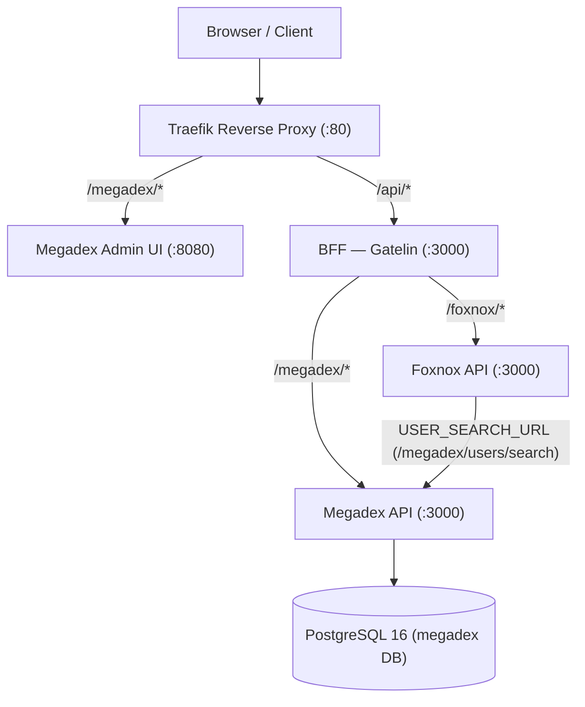

# Request Flow & Architecture

## Express Request Pipeline

```
Client / BFF Request
    ↓
[express.json] — JSON body parsing (100kb limit)
    ↓
[/megadex/health] — Liveness & PostgreSQL readiness (registered first)
    ↓
[startTimer] — @dwtechs/winstan-plugin-express-perf timing middleware
    ↓
[Resource Routers (/megadex/*)]
    ├── /audit        → enforceAcl(auditEnt, "search") → auditEnt.get → computeChanges → send(auditEnt)
    ├── /users        → requireConsumer / enforceAcl / rolesToDatabase / userEnt.* / rolesToApi → send(userEnt)
    ├── /preferences  → requireConsumer / mapConsumer / ownership checks / preferenceEnt.* → send(preferenceEnt)
    ├── /socials      → requireConsumer / enforceAcl / socialEnt.* → send(socialEnt)
    ├── /countries    → enforceAcl(country, "search") / country.get → send(country)
    ├── /civilities   → enforceAcl(civility, "search") / civility.get → send(civility)
    └── /genders      → enforceAcl(gender, "search") / gender.get → send(gender)
    ↓
[errorHandler] — @dwtechs/errandler-express structured error formatting
```

## Terminal Response Middleware (`send`)

Every resource router finishes with `send(entity)` (`src/middlewares/res/send.js`):

1. **Private property stripping** — Removes any property marked `privateField: true` on the `SQLEntity` definition (such as `rolesArrayAgg` on `users`, `userId` on `preferences`, and `record`/`previous`/`changedKeys` on `audit`).
2. **ACL field projection** — When the BFF supplies an `x-acl-fields` header, projects outgoing rows down to the permitted field list (`id` is always preserved).
3. **Envelope formatting** — Sends `{ rows, total }` when `res.locals.total` is present (paginated searches) or `{ rows }` otherwise.

## Role Mapping Middleware (`user-roles.js`)

In the database `users` view, aggregated role IDs live in the column `"rolesArrayAgg"` (`int[]`), which is marked `privateField: true` on `userEnt` so internal SQL queries can read and write it. The middleware in `src/middlewares/user-roles.js` bridges the public API contract (`roles`) and the database column (`rolesArrayAgg`):

- **`rolesToDatabase`**: On `POST /users` and `PUT /users`, validates and translates incoming `row.roles` into `row.rolesArrayAgg` before `antity-pgsql` executes the `INSERT` or `UPDATE`.
- **`rolesToApi`**: On `POST /users/search`, `POST /users`, and `PUT /users`, copies `row.rolesArrayAgg` onto `row.roles` before `send(userEnt)` strips `rolesArrayAgg`.
- **`rolesToSchema`**: On `GET /users/schema`, appends the `roles` array descriptor to the schema output so the Admin UI knows `roles` is a writable array field.

## Where Megadex Sits in the Stack



## Technology Stack

| Layer | Technology |
|---|---|
| Runtime | Node.js 24 (ES Modules) |
| Web Framework | Express 5 + `@dwtechs/servpico-express` |
| Database Access | PostgreSQL 16 via `@dwtechs/antity-pgsql` `0.25.0` |
| Validation | `@dwtechs/checkard` |
| Logging | `@dwtechs/winstan` |
| Migrations | Liquibase |
| Admin UI | Angular 22, PrimeNG 21, `@dwtechs/ngx-crud-builder` `0.3.5` |
| Documentation | VitePress + Mermaid |
