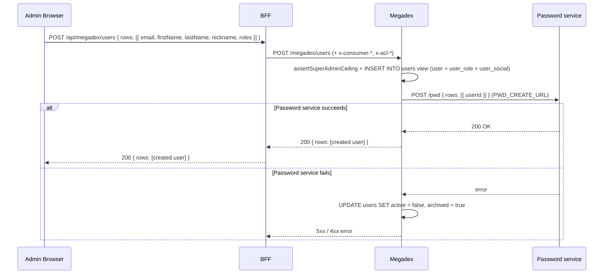
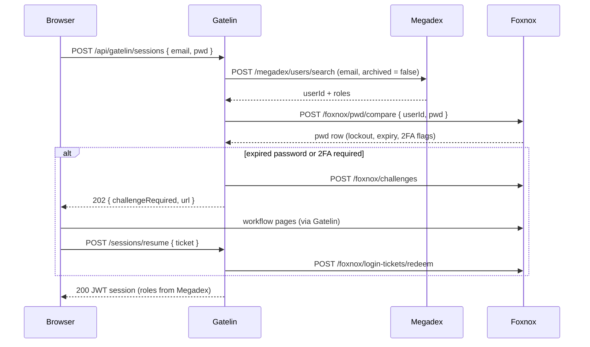
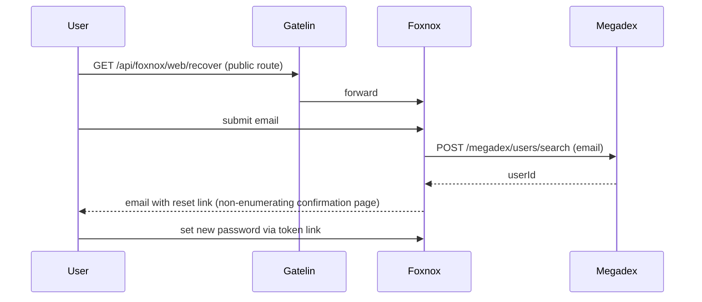

# Request Flow & Architecture

## Request Pipeline

```
Client / BFF Request
    ↓
[express.json] - JSON body parsing, 100kb limit
    ↓
[/megadex/health] - Liveness + DB readiness (registered first, bypasses everything else)
    ↓
[startTimer] - Performance measurement
    ↓
[JSON routers]
    ├── /megadex/audit        → enforceAcl(auditEnt, "search") → auditEnt.get → buildChanges → send(auditEnt)
    ├── /megadex/users        → search / me / create / update / archive / schema / history     → send(userEnt)
    ├── /megadex/preferences  → requireConsumer → mapConsumer → preference CRUD                → send(preferenceEnt)
    ├── /megadex/socials      → social catalog CRUD                                            → send(socialEnt)
    ├── /megadex/countries    → enforceAcl(country, "search") → country.get                    → send(country)
    ├── /megadex/civilities   → enforceAcl(civility, "search") → civility.get                  → send(civility)
    └── /megadex/genders      → enforceAcl(gender, "search") → gender.get                      → send(gender)
    ↓
[errorHandler]
```

**Health is registered before the timer and every router**, so a liveness probe never depends on anything else working. `/megadex/health` is dependency-free; `/megadex/health/ready` additionally runs `SELECT 1` against Postgres so an instance that lost its database leaves rotation instead of failing requests.

## Response & Mapping Middlewares

Every JSON router ends in the terminal `send(entity)` middleware (`src/middlewares/res/send.js`), which enforces privacy and field projection at the boundary:

| Middleware | Used by | Role |
|---|---|---|
| `rolesToDatabase` / `rolesToApi` / `rolesToSchema` | `users` | Maps public `roles` (`int[]`) to/from the private database column `rolesArrayAgg` on the `users` view, and exposes `roles` in `/megadex/users/schema`. |
| `buildChanges` | `audit` | Builds the `changes` text (`key: previous → new`, one line per field) from `log.audit` snapshots and redacts sensitive keys. |
| `send(userEnt)` | `users` | Strips `rolesArrayAgg` (`privateField: true`) and projects `x-acl-fields`. |
| `send(preferenceEnt)` | `preferences` | Strips `userId` (`privateField: true`) and projects `x-acl-fields`. |
| `send(auditEnt)` | `audit` | Strips raw `record`, `previous`, and `changedKeys` (`privateField: true`) so only computed `changes` leave the service. |

## ACL, Consumer & Privilege Boundaries

Megadex carries no JWT or session logic of its own. Authentication and route permission checks happen in the BFF. Megadex then enforces the consumer identity, field allow-lists, row conditions, and role hierarchy at its own data boundary:

- `x-consumer-user-id` and `x-consumer-name` are validated by `requireConsumer` and mapped to `res.locals.consumer`, allowing `@dwtechs/antity-pgsql` and database triggers to stamp `creatorId`, `creatorName`, `updaterId`, `updaterName`, and `log.history` on every write.
- `x-acl-fields` filters incoming write rows before entity validation and projects outgoing rows, schema descriptors, and history `record` snapshots. `id` is always retained. An omitted header is unrestricted; an empty header allows only `id`.
- `x-acl-conditions` is a JSON array of `{ field, op, value }`. Search predicates are forced into the query with `AND`. Inserts must satisfy the partition (an absent equality field is injected), and update/archive/history target IDs are checked before the operation. Updates cannot move a row outside its partition.
- `assertSuperAdminCeiling` queries `user_role` on `POST /megadex/users`, `PUT /megadex/users`, and `POST /megadex/users/archive` to guarantee that only a caller holding role `1` (**Super admin**) can assign role `1` or modify/archive an existing user who holds role `1`.

Malformed ACL or consumer headers, unknown/non-filterable fields, and unsupported operators fail closed with **403**.

## Where Megadex Sits

```
┌─────────────────────────────────────────────────┐
│                  Reverse Proxy                   │
│                    (Traefik)                     │
│              http://your-domain.com              │
└────────────┬─────────────────────┬───────────────┘
             │                     │
   ┌─────────▼─────────┐  ┌────────▼──────────┐
   │   Admin Panel     │  │        BFF        │
   │   /megadex/*      │  │      /api/*       │
   │   (Angular)       │  │     (Node.js)     │
   └───────────────────┘  └────────┬──────────┘
                                   │  internal network only
                          ┌────────▼──────────┐
                          │      Megadex      │
                          │     /megadex      │
                          │     (Node.js)     │
                          └────────┬──────────┘
                                   │
                          ┌────────▼──────────┐
                          │   PostgreSQL 16   │
                          │   (megadex DB)    │
                          └───────────────────┘
```

Megadex has **no public API route**. Every external request reaches it through a BFF, while internal services (the BFF and the password service) call `/megadex/users/search` directly on the internal network to resolve email addresses to user IDs. The password service is reached through `PWD_CREATE_URL`; see [Integration](./integration).

## User Lifecycle, End to End

Creating, updating, or archiving a user involves Megadex, the BFF, and the password service over the internal network:



When an administrator later deactivates that user (`active: false`), changes their `roles`, or archives them (`POST /megadex/users/archive`), Megadex does not revoke the user's cached BFF session. Archived or inactive users cannot refresh their sessions, which remain usable until the current access token expires.

## Working Together: Gatelin, Foxnox and Megadex

Megadex is one of three cooperating services: [Gatelin](https://gatelin.fr) is the BFF in front, [Foxnox](https://foxnox.fr) holds credentials, and Megadex holds the user records both of them depend on.

```
┌─────────────────────────────────────────────────┐
│                  Reverse Proxy                   │
│                    (Traefik)                     │
│              http://your-domain.com              │
└────────────┬─────────────────────┬───────────────┘
             │                     │
   ┌─────────▼─────────┐  ┌────────▼──────────┐
   │   Admin Panels    │  │      Gatelin      │
   │     (Angular)     │  │   BFF  /api/*     │
   └───────────────────┘  └────────┬──────────┘
                                   │  internal network only
            ┌──────────────────────┼──────────────────────┐
            │                      │                      │
   ┌────────▼──────────┐           │             ┌────────▼──────────┐
   │      Megadex      │◄──────────┴─────────────┤      Foxnox       │
   │     /megadex      │     USER_SEARCH_URL     │  /foxnox  /web    │
   │     (Node.js)     ├────────────────────────►│     (Node.js)     │
   └────────┬──────────┘     PWD_CREATE_URL      └────────┬──────────┘
            │                                             │
   ┌────────▼──────────┐                         ┌────────▼──────────┐
   │    PostgreSQL     │                         │    PostgreSQL     │
   │   (megadex DB)    │                         │   (foxnox DB)     │
   └───────────────────┘                         └───────────────────┘
```

Each service owns its own database and knows the others only by HTTP contract.

| Service | Owns | Never does |
|---|---|---|
| **Gatelin** | Sessions, JWTs, routes, roles, permissions, CORS | Store password hashes or user profiles |
| **Megadex** | Users, roles assignment, social links, preferences, lookups | Store credentials or issue sessions |
| **Foxnox** | Password hashes, 2FA, tokens, trusted devices, workflow pages | Mint JWTs or store user profiles |

Users are identified by email at the edge and by numeric `userId` everywhere else. Megadex is the only place that translates one into the other.

### Sign-in



### Account creation

See [User Lifecycle, End to End](#user-lifecycle-end-to-end): Megadex creates the user, then asks Foxnox to create its password, and soft-archives the user if Foxnox fails.

### Password recovery



### Who calls whom

| Caller | Callee | Variable | Purpose |
|---|---|---|---|
| Gatelin | Megadex | `USER_SEARCH_URL` | Resolve email to `userId` at login |
| Gatelin | Foxnox | `PWD_CHECK_URL` | Verify the password |
| Gatelin | Foxnox | `PWD_CHALLENGES_URL`, `PWD_TRUSTED_DEVICES_URL`, `PWD_LOGIN_TICKET_URL` | Mid-login 2FA / expired-password steps |
| Foxnox | Megadex | `USER_SEARCH_URL` | Resolve email in recovery, unlock, and 2FA recovery |
| Megadex | Foxnox | `PWD_CREATE_URL` | Create a password on user creation; archive it on user archival |
| Gatelin | Megadex, Foxnox | Route and permission seeds | Proxy admin and self-service traffic with consumer and ACL headers |

### Boundaries to keep in mind

- **Trust**: Megadex and Foxnox trust Gatelin's `x-consumer-*` and `x-acl-*` headers, so only Gatelin (and each other) may reach their ports. Neither should have a public router.
- **Sessions**: Gatelin owns session state. Role changes or archival in Megadex take effect only when the access token expires or refresh fails; nothing pushes a revocation.
- **Coupling**: Megadex creating a user fails (and rolls back by archiving) if Foxnox is down. Gatelin login fails if Megadex or Foxnox is unreachable.
- **Optional**: Each service works with other implementations of the same HTTP contract. A custom BFF, user service, or credential store can replace any one of the three.

### Reference values

The other pages use generic placeholders. For the three services shipped together, the concrete values are:

| Placeholder | Concrete value |
|---|---|
| `<bff-image>` / `<bff-migration-image>` | `ghcr.io/alten-group/gatelin` / `ghcr.io/alten-group/gatelin-migration` |
| `<bff-seed-folder>` | `gatelin-data` (`db/liquibase/gatelin-data/` in the Foxnox and Megadex checkouts) |
| `/api/<bff>/roles/search` (`ADMIN_ROLES_SEARCH_URL`) | `/api/gatelin/roles/search` |
| Password service URLs (`/pwd`, `/pwd/compare`, `/challenges`, `/devices/verify`, `/login-tickets/redeem`) | the same paths under `/foxnox`, on `ghcr.io/alten-group/foxnox` |
| `ADMIN_PASSWORD_RECOVERY_URL` example (`/api/password-service/web/recover`) | `/api/foxnox/web/recover` |
| User service URL (`/users/search`) | `/megadex/users/search`, on `ghcr.io/alten-group/megadex` |

## Background Jobs

Started with the process, before the HTTP listener, using a dedicated pool (`DB_JOB_USER`):

- **Delete archived entities** — daily 02:00 UTC; hard-deletes `"user"` and `social` rows archived for more than 2 months via `public.delete()`
- **Delete old history** — daily 03:00 UTC; removes `log.history` rows older than 6 months

## Technology

| Layer | Choice |
|---|---|
| Runtime | Node.js 24, ES modules |
| HTTP | Express 5, `@dwtechs/servpico-express` |
| Database | PostgreSQL 16, via `@dwtechs/antity-pgsql` |
| Migrations | Liquibase |
| Validation | `@dwtechs/checkard` |
| Logging | `@dwtechs/winstan` |
| Admin UI | Angular 22 with OpenNG Optimus UI and `@dwtechs/ngx-crud-builder` |
