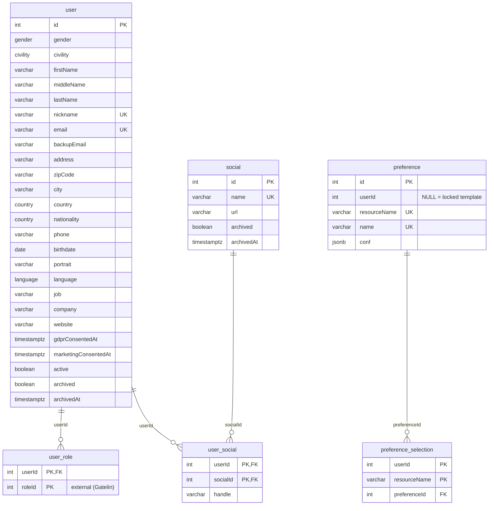
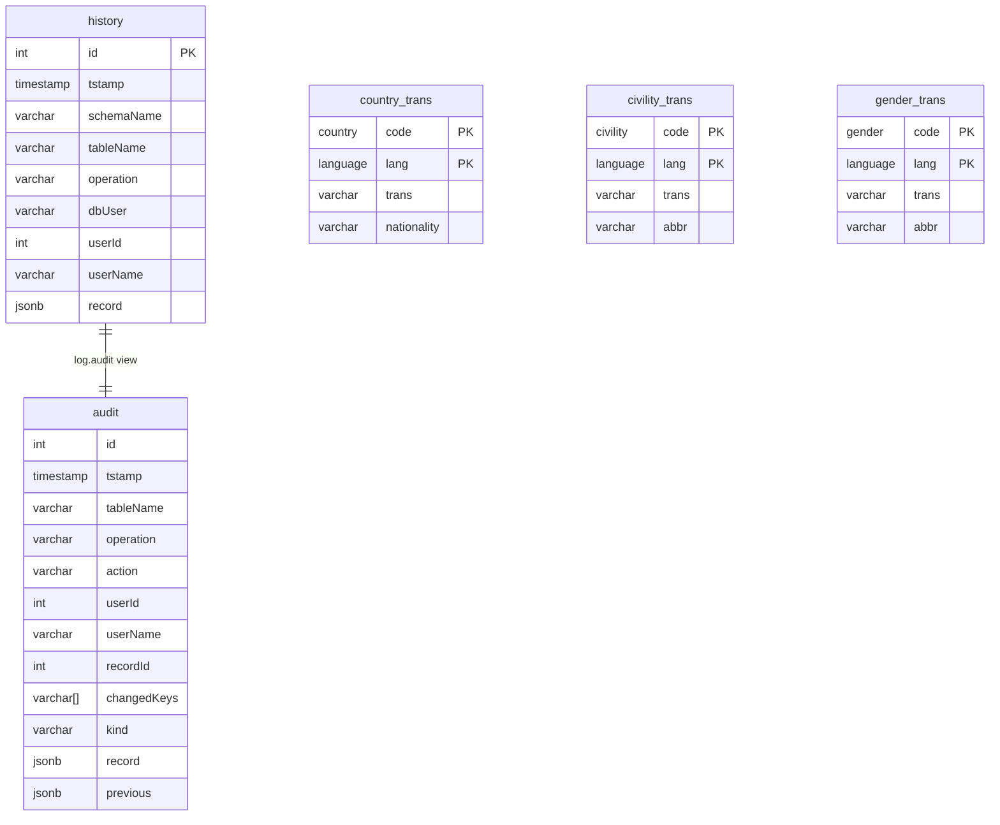

# Data Model

Megadex owns its own PostgreSQL database (`megadex` by default). Roles live in your BFF ([Gatelin](https://gatelin.fr)) — `user_role` stores plain `roleId` integers with no foreign key, because the `role` table is in the BFF's database.

## Users, Roles, Socials & Preferences

### `user` and the `users` writable view

The `"user"` base table holds core profile attributes, consent timestamps, and lifecycle flags (`active`, `archived`, `archivedAt`). `nickname` and `email` are case-insensitively unique (`lower(nickname)`, `lower(email)`).

Applications never query `"user"` directly. Instead, Megadex reads and writes the **`users` view**, which joins `"user"` with:

- `"rolesArrayAgg"` — `ARRAY_AGG(user_role."roleId" ORDER BY "roleId")` (mapped by the Express layer to `roles`)
- `"socialsJsonAgg"` — `JSON_OBJECT_AGG(social.name, user_social.handle)` for non-archived social platforms

An `INSTEAD OF INSERT OR UPDATE` trigger (`iud_user`) makes the `users` view directly writable: inserting or updating a row on `users` writes the `"user"` table, reconciles `user_role` rows, and calls `set_user_socials()` to resolve platform names against `social` and upsert or delete `user_social` rows in a single transaction.

### `social`

Catalog of supported social platforms (`Facebook`, `GitHub`, `Instagram`, `LinkedIn`, `Pinterest`, `Reddit`, `Snapchat`, `TikTok`, `Twitch`, `WhatsApp`, `X`, `YouTube` seeded by default). Adding a platform requires only inserting a row into `social`; archiving a platform prevents it from being assigned in `socialsJsonAgg`.

### `preference` and the `preferences` writable view

Stores table column layouts (`conf`) for the Admin UI (`users` and `socials` resources).

- Rows where `userId IS NULL` are **locked system templates** (`locked = true`).
- Rows where `userId IS NOT NULL` belong to that operator (`locked = false`), capped at **5** per user and per resource by trigger `check_preference_limit`.
- `preference_selection` tracks which `preferenceId` a user currently has active for each `resourceName` (falling back to the `"Default"` template when no row exists).

The writable **`preferences` view** exposes `locked` and `isActive` as computed columns and uses an `INSTEAD OF` trigger (`iud_preference`) to implement copy-on-write when an operator customizes a locked template.

## Reference Lookups & Audit Views

`country_trans`, `civility_trans`, and `gender_trans` hold localized labels in English (`en`) and French (`fr`), keyed by PostgreSQL domain codes (`country`, `civility`, `gender`, `language`).

## Conventions

Every mutable table follows the same four patterns:

**Soft deletion.** User and social catalog rows are never hard-deleted through the HTTP API. Calling `/archive` calls `public.set_archived()`, which flags `archived = true` and stamps `archivedAt`. The nightly job hard-deletes archived rows after two months.

**Audit columns.** Mutable tables carry `createdAt`, `creatorId`, `creatorName`, `updatedAt`, `updaterId`, and `updaterName`, stamped from the `x-consumer-user-id` and `x-consumer-name` headers forwarded by the BFF (or `-1` / `system` for seed data).

**History triggers.** Database triggers record every `INSERT`, `UPDATE`, and `DELETE` on `"user"`, `user_role`, `user_social`, and `social` into `log.history`. Per-row history is exposed via `GET /:id/history`, while `log.audit` pairs each entry with its previous snapshot to power `POST /megadex/audit/search`. History older than six months is purged nightly.

**Least-privilege database roles.** The migration entrypoint provisions two PostgreSQL roles: `DB_USER` (used by the HTTP server, with no `DELETE` privilege on `"user"`, `social`, or `log.history`) and `DB_JOB_USER` (used only by the nightly cleanup cron jobs).

## Migrations

The schema is managed by Liquibase in `db/liquibase/megadex/`, applied by the `ghcr.io/alten-group/megadex-migration` container. Changesets are grouped by purpose — `01-hist`, `02-func`, `03-struct`, `04-view`, `05-trig`, and `06-data` — and the migration also creates the database and both PostgreSQL roles on a fresh install. See [Deployment](./deployment#database-migration).
