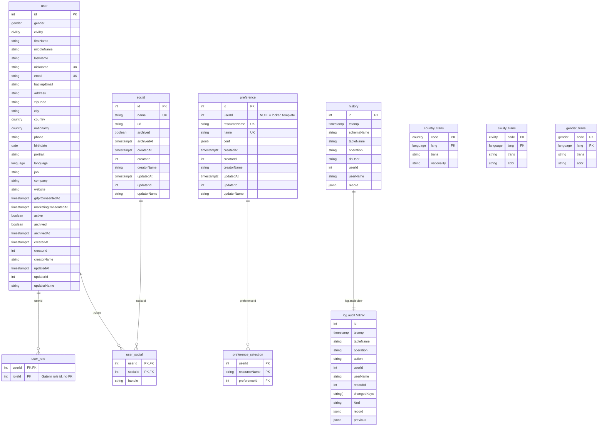

# Database & Migrations

Megadex uses **PostgreSQL 16** and manages schema changes, functions, views, triggers, and reference data through **Liquibase**.

## Entity Relationship Diagram

## Database Views

Megadex exposes three primary SQL views:

| View | Schema | Type | Purpose |
|---|---|---|---|
| `users` | `public` | Writable (`INSTEAD OF INSERT OR UPDATE`) | Joins `"user"` with aggregated `rolesArrayAgg` (`user_role`) and `socialsJsonAgg` (`user_social` + `social`). |
| `preferences` | `public` | Writable (`INSTEAD OF INSERT OR UPDATE OR DELETE`) | Merges locked templates (`userId IS NULL`) and personal preferences with `isActive` from `preference_selection`. |
| `audit` | `log` | Read-only | Enriches `log.history` with the previous snapshot (`LATERAL` lookup), changed keys, `action` (`ARCHIVE`/`RESTORE`), and `kind` (`change`/`routine`). |

## Least-Privilege Database Roles

The Liquibase entrypoint (`db/liquibase/entrypoint.sh`) provisions two distinct PostgreSQL roles with least-privilege grants:

1. **`DB_USER` (Application role)**:
   - `SELECT, INSERT, UPDATE` on `"user"`, `social`, `users`
   - `SELECT, INSERT, UPDATE, DELETE` on `user_role`, `user_social`, `preference`, `preference_selection`, `preferences`
   - `SELECT` on `country_trans`, `civility_trans`, `gender_trans`, `log.history`, `log.audit`
   - `INSERT` on `log.history`
   - `EXECUTE` on `public.set_archived(text, integer, text, integer[])` (cannot hard-delete `"user"` or `social` rows)
2. **`DB_JOB_USER` (Cron maintenance role)**:
   - `EXECUTE` on `public.delete(text, timestamptz)` (`SECURITY DEFINER` function that hard-deletes rows where `archived = TRUE AND archivedAt < cutoff`)
   - `DELETE, SELECT` on `log.history`

## Custom Seed Data

In development or custom deployments, mount a directory containing a Liquibase `changelog.xml` at `/liquibase/data` on the `megadex-migration` container. The entrypoint automatically runs `/liquibase/data/changelog.xml` after the core schema and reference catalogs have been applied.
